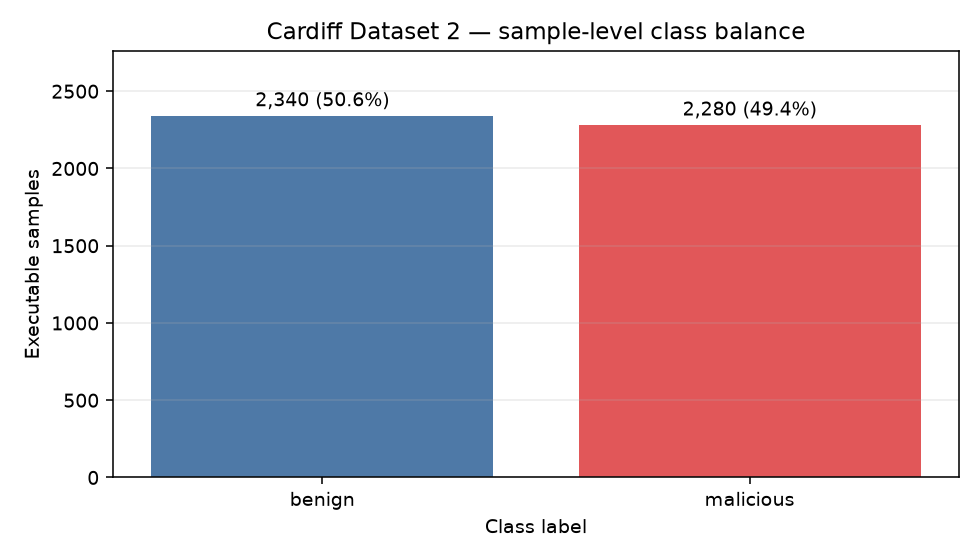
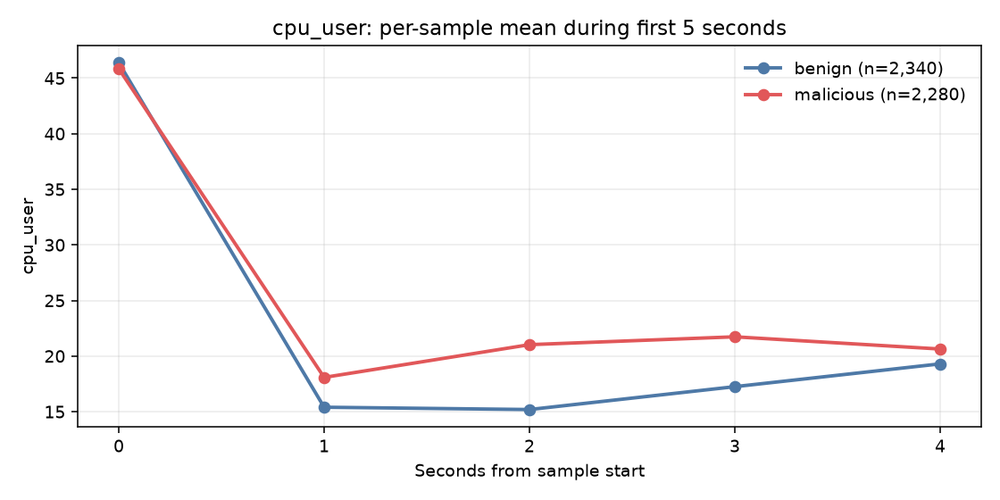
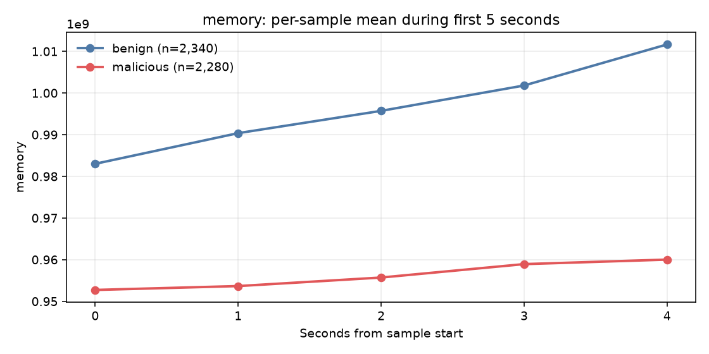
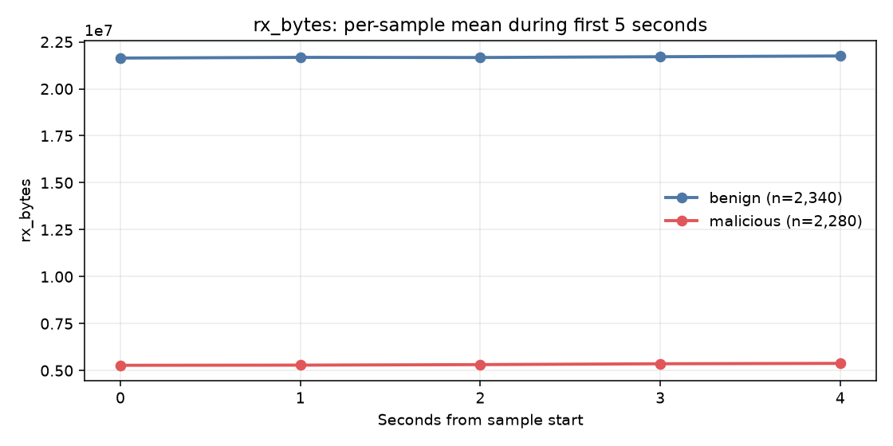
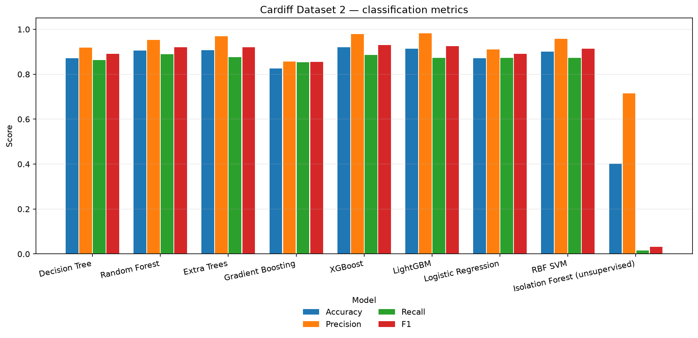
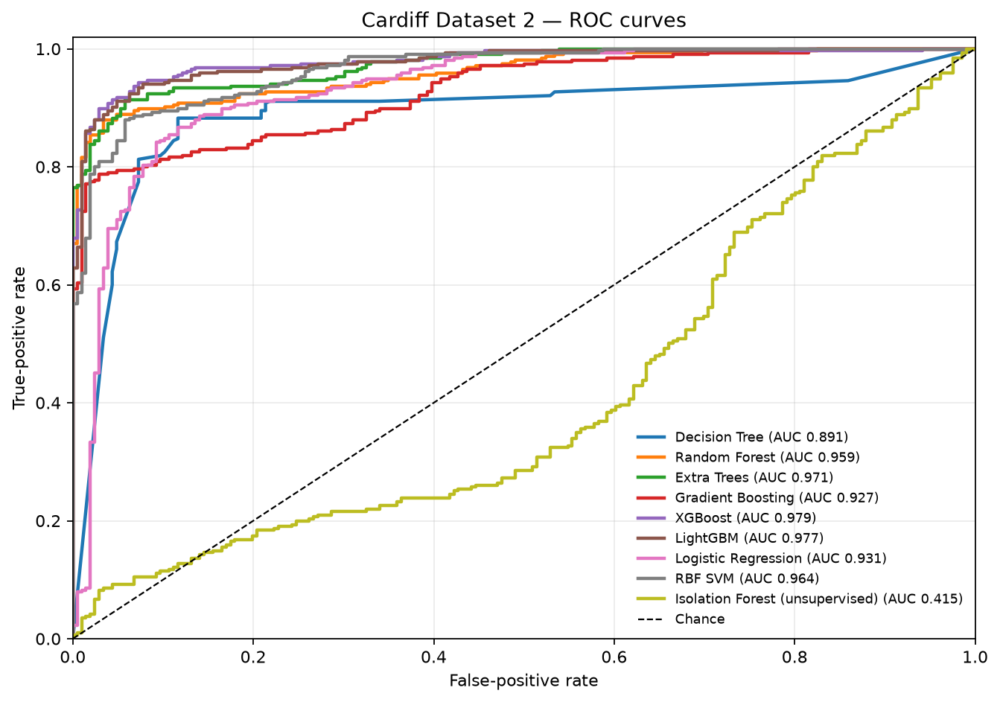
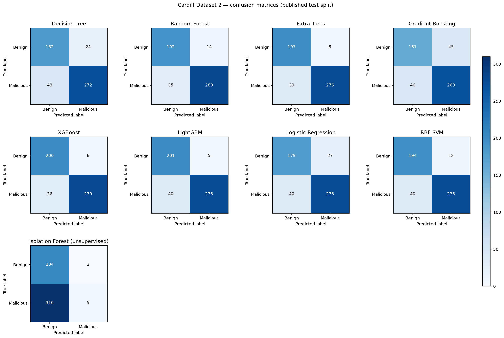

# Báo cáo dataset, mô hình và kết quả huấn luyện

**Đề tài:** Phát hiện mã độc từ telemetry hành vi  
**Lượt huấn luyện:** `20261018_165326_231804`  
**Ngày chạy:** 18/10/2026  
**Dataset được đánh giá:** Cardiff Dataset 2  
**Cửa sổ quan sát:** 5 giây

## 1. Tóm tắt

Pipeline đã làm sạch và chuyển **4.620 mẫu** Cardiff thành vector đặc trưng gồm **50 giá trị/mẫu**. Dữ liệu được chia theo cột `test_set` công bố cùng dataset: **4.099 mẫu train** và **521 mẫu test**. Tám mô hình supervised và một mô hình unsupervised được huấn luyện, lưu checkpoint và đánh giá trên cùng test split.

Trong lượt chạy này, **XGBoost** có F1 cao nhất (**0,9300**), ROC AUC **0,9785** và PR AUC **0,9876**. **LightGBM** có false-positive rate thấp nhất trong các mô hình supervised (**0,0243**); **Random Forest** có recall cao nhất (**0,8889**). Đây là kết quả offline trên Cardiff, không phải tỷ lệ phát hiện trên máy thật.

## 2. Dataset và nguồn dữ liệu

### 2.1 Cardiff Dataset 2 — nguồn dùng để huấn luyện

Dataset được tải từ hồ sơ Cardiff University Figshare, *Behavioural machine activity for benign and malicious Win7 64-bit executables*, [DOI 10.17035/d.2018.0050524986](https://doi.org/10.17035/d.2018.0050524986). Dataset 2 ban đầu ghi nhận **2.345 mẫu benign** và **2.286 mẫu malicious**. Các mẫu được thu trong máy ảo 64-bit Windows 7 bằng VirtualBox và Cuckoo Sandbox; telemetry được thu bằng psutil trong tối đa 20 giây. Dataset cung cấp nhãn `malware` (0 benign, 1 malicious), định danh mẫu, thời điểm quan sát và cột `test_set` chỉ định split được công bố. Dataset phát hành theo giấy phép CC BY 4.0. [Hồ sơ và mô tả dataset](https://figshare.com/articles/dataset/Behavioural_machine_activity_for_benign_and_malicious_Win7_64-bit_executables/27052333)

Các trường telemetry sử dụng trong báo cáo:

| Nhóm | Trường |
|---|---|
| CPU và bộ nhớ | `cpu_system`, `cpu_user`, `memory`, `swap` |
| Hệ thống tiến trình | `total_processes`, `max_pid` |
| Mạng | `rx_bytes`, `tx_bytes`, `rx_packets`, `tx_packets` |

Cardiff cũng phát hành Dataset 1 với thời lượng chạy và cách thu thập khác. Lượt huấn luyện này **chỉ dùng Dataset 2 (`data_2.csv`)**; không gộp Dataset 1 vì khác cấu trúc/thời lượng, và pipeline đang bám theo split cùng cấu hình nghiên cứu của Dataset 2.

### 2.2 Dữ liệu ProcessGuard tự thu thập — chưa đưa vào kết quả

ProcessGuard có chức năng ghi telemetry PID kèm nhãn và `label_source`, nhưng file `data/observations/collected_samples.csv` chưa tồn tại tại thời điểm lập báo cáo. Vì vậy dữ liệu này **chưa được dùng và chưa được gộp** với Cardiff. Hai nguồn có phạm vi và ngữ nghĩa khác nhau: Cardiff ghi hoạt động toàn máy trong lúc một executable chạy trong sandbox, còn dữ liệu ProcessGuard hướng tới tiến trình live. Cần có dữ liệu đã xác minh nhãn và thống nhất feature trước khi đánh giá kết hợp.

Do khác biệt đó, model Cardiff hiện chỉ phục vụ nghiên cứu trên mẫu sandbox; không dùng trực tiếp để gán nhãn một PID live.

## 3. Tiền xử lý và tạo đặc trưng

Pipeline trong `process_guard/cardiff.py` thực hiện các bước sau:

1. Chuẩn hóa tên cột, chuyển các trường số về dạng numeric và bỏ hàng thiếu nhãn, thời điểm hoặc một trong 10 feature yêu cầu. Tên cột cũ như `cpu_sysem` và `total_pro` được ánh xạ sang tên chuẩn.
2. Chỉ giữ nhãn 0/1 và sắp xếp theo `sample_id`, `vector`.
3. Loại sample ID có nhãn hoặc cờ train/test mâu thuẫn. Lượt chạy này loại **11 sample ID mâu thuẫn**, còn **4.620 mẫu**.
4. Với mỗi mẫu, lấy các quan sát có `vector < 5`; nếu một giây có nhiều hàng thì lấy trung bình theo giây. Mốc giây bị thiếu được điền bằng quan sát gần nhất; trace ngắn hơn 5 giây được lấp bằng giá trị cuối cùng.
5. Giữ nguyên split `test_set` ở cấp sample để không đưa các thời điểm của cùng mẫu sang cả train và test. Kết quả là 5 mốc thời gian × 10 feature = **50 feature/mẫu**.

Phân bố split của lượt chạy:

| Split | Benign | Malicious | Tổng |
|---|---:|---:|---:|
| Train | 2.134 | 1.965 | 4.099 |
| Test | 206 | 315 | 521 |

## 4. Phân tích khám phá dữ liệu (EDA)

EDA được tạo bằng `scripts/eda.py`. Phân tích nhãn dùng một dòng cho mỗi sample; biểu đồ xu hướng và bảng so sánh feature dùng cùng cửa sổ 5 giây, cùng cách điền mốc thời gian thiếu như pipeline model.

### Phân bố nhãn

| Nhãn | Số mẫu | Tỷ lệ |
|---|---:|---:|
| Benign | 2.340 | 50,6% |
| Malicious | 2.280 | 49,4% |
| **Tổng** | **4.620** | **100%** |

Tập sau lọc gần cân bằng ở cấp sample; lượt này không áp dụng oversampling. Split test công bố lại lệch về malicious (206 benign, 315 malicious); các metric trên test cần được đọc cùng phân bố đó.



### Khác biệt feature trong 5 giây đầu

Bảng sau tính trung bình 5 mốc thời gian cho từng sample trước khi tổng hợp theo nhãn. Mỗi executable có cùng trọng số. Median được đưa kèm mean để thấy ảnh hưởng của phân bố lệch và giá trị cực đoan.

| Feature | Benign mean | Malicious mean | Benign median | Malicious median | Quan sát |
|---|---:|---:|---:|---:|---|
| CPU system (%) | 21,83 | 14,69 | 16,78 | 11,92 | Trung bình benign cao hơn trong cửa sổ này |
| CPU user (%) | 22,70 | 25,46 | 21,28 | 23,88 | Trung bình malicious cao hơn |
| Memory (MB, decimal) | 996,5 | 956,2 | 988,9 | 951,6 | Benign cao hơn; mức chênh cần xem trong bối cảnh VM |
| Total processes | 46,61 | 45,24 | 46,8 | 44,8 | Khác biệt trung bình nhỏ |
| RX bytes (MB, decimal) | 21,69 | 5,32 | 7,12 | 4,43 | Khác biệt lớn; số byte nhận là telemetry toàn máy |
| TX packets | 2.749 | 1.447 | 2.312 | 900 | Malicious thấp hơn trong mẫu này |

CPU system, memory, số tiến trình và RX bytes có trung bình benign cao hơn trong cửa sổ 5 giây; CPU user cao hơn ở lớp malicious. Trong các đường thời gian, CPU user gần như bằng nhau tại giây 0 rồi malicious cao hơn từ giây 1 đến giây 4. RX bytes khác biệt rõ và ổn định theo thời gian, trong khi TX bytes tăng ở cả hai lớp và hai đường gần nhau hơn ở giây 4.

Đây là khác biệt của nhóm mẫu trong môi trường sandbox, không phải dấu hiệu đủ để phân loại một executable riêng lẻ. Cardiff thu counters toàn máy; chẳng hạn RX bytes không thể quy trực tiếp cho tiến trình đang được chạy. Mean cao hơn median đáng kể ở một số chỉ số mạng, cho thấy dữ liệu có thể lệch phải/ảnh hưởng bởi một số giá trị lớn; vì vậy không nên diễn giải mean như ngưỡng phân loại.







### Phạm vi và trọng số của thống kê

File `cardiff_eda_by_label.csv` giữ thống kê tham khảo trên toàn bộ **76.222 dòng telemetry**: 43.654 dòng benign và 32.568 dòng malicious. Vì số dòng trên mỗi sample không đồng đều, tổng hợp trực tiếp các dòng này cho mỗi sample trọng số khác nhau. Bảng và biểu đồ xu hướng 5 giây ở trên thay vào đó dùng một sequence đã chuẩn hóa cho mỗi sample. Chi tiết mean/median/std theo sample được lưu trong `cardiff_eda_by_sample_5s.csv`.

## 5. Mô hình được huấn luyện

Tám mô hình supervised được huấn luyện trên các mẫu training chính thức; Isolation Forest được fit trên phần benign của training set để làm baseline unsupervised. XGBoost và LightGBM được cài như dependencies tùy chọn trong `requirements-modern-ml.txt`.

| Mô hình | Cấu hình chính |
|---|---|
| Decision Tree | `max_depth=9`, class weight balanced |
| Random Forest | 250 cây, `min_samples_leaf=2`, class weight balanced |
| Extra Trees | 250 cây, `min_samples_leaf=2`, class weight balanced |
| Gradient Boosting | 150 cây, learning rate 0,05, depth 2 |
| XGBoost | 300 cây, learning rate 0,05, depth 4, subsample/column sample 0,85, histogram tree method |
| LightGBM | 300 cây, learning rate 0,05, depth 4, 15 leaves, subsample/column sample 0,85 |
| Logistic Regression | Chuẩn hóa StandardScaler, class weight balanced, tối đa 3.000 vòng lặp |
| RBF SVM | Chuẩn hóa StandardScaler, `C=1`, class weight balanced |
| Isolation Forest | 250 cây, contamination tự động; fit chỉ trên benign train |

XGBoost và LightGBM được dùng qua API tương thích scikit-learn. [Tài liệu XGBoost](https://xgboost.readthedocs.io/en/stable/python/python_intro.html) · [Tài liệu LightGBM](https://lightgbm.readthedocs.io/en/stable/Python-API.html).

## 6. Kết quả

Các metric dưới đây được tính trên cùng **521 mẫu test**. `FPR` là tỷ lệ benign bị phân loại nhầm là malicious. `PR AUC` trong báo cáo tương ứng Average Precision.

Accuracy là tỷ lệ dự đoán đúng trên toàn bộ test; precision là tỷ lệ dự đoán malicious thực sự mang nhãn malicious; recall là tỷ lệ mẫu malicious được phát hiện; F1 là trung bình điều hòa của precision và recall. ROC AUC và Average Precision tóm tắt khả năng xếp hạng theo nhiều ngưỡng; không đồng nghĩa với metric tại ngưỡng dự đoán mặc định.

| Mô hình | Accuracy | Balanced acc. | Precision | Recall | F1 | FPR | ROC AUC | PR AUC | Fit (giây) | Predict (ms/mẫu) |
|---|---:|---:|---:|---:|---:|---:|---:|---:|---:|---:|
| Decision Tree | 0,8714 | 0,8735 | 0,9189 | 0,8635 | 0,8903 | 0,1165 | 0,8909 | 0,9213 | 0,1039 | 0,0019 |
| Random Forest | 0,9060 | 0,9105 | 0,9524 | **0,8889** | 0,9195 | 0,0680 | 0,9595 | 0,9778 | 0,6380 | 0,3911 |
| Extra Trees | 0,9079 | 0,9163 | 0,9684 | 0,8762 | 0,9200 | 0,0437 | 0,9713 | 0,9833 | 0,4519 | 0,3912 |
| Gradient Boosting | 0,8253 | 0,8178 | 0,8567 | 0,8540 | 0,8553 | 0,2184 | 0,9272 | 0,9588 | 3,6074 | 0,0036 |
| **XGBoost** | **0,9194** | **0,9283** | 0,9789 | 0,8857 | **0,9300** | 0,0291 | **0,9785** | **0,9876** | 0,3121 | 0,0067 |
| LightGBM | 0,9136 | 0,9244 | **0,9821** | 0,8730 | 0,9244 | **0,0243** | 0,9768 | 0,9862 | 0,2628 | 0,0107 |
| Logistic Regression | 0,8714 | 0,8710 | 0,9106 | 0,8730 | 0,8914 | 0,1311 | 0,9314 | 0,9344 | 0,0361 | 0,0026 |
| RBF SVM | 0,9002 | 0,9074 | 0,9582 | 0,8730 | 0,9136 | 0,0583 | 0,9643 | 0,9775 | 0,4426 | 0,1237 |
| Isolation Forest (unsupervised) | 0,4012 | 0,5031 | 0,7143 | 0,0159 | 0,0311 | 0,0097 | 0,4146 | 0,5795 | 0,2876 | 0,1805 |

### Nhận xét

- XGBoost cho F1 cao nhất (**0,9300**) và phân loại đúng 479/521 mẫu ở ngưỡng mặc định.
- LightGBM có FPR thấp nhất trong các mô hình supervised (**0,0243**, tương ứng 5 false positive trên 206 mẫu benign), đồng thời precision đạt 0,9821.
- Random Forest nhỉnh hơn XGBoost về recall (**0,8889** so với 0,8857), tức bỏ sót ít hơn một chút trên test này.
- Confusion matrix XGBoost, theo thứ tự nhãn `[benign, malicious]`, là `[[200, 6], [36, 279]]`: 200 benign đúng, 6 benign báo nhầm, 36 malicious bỏ sót, 279 malicious phát hiện đúng.
- Isolation Forest có false-positive rate thấp nhưng recall chỉ 0,0159; cấu hình baseline này không phù hợp nếu mục tiêu là phát hiện phần lớn malware.
- Thời gian fit/inference phụ thuộc máy, CPU và threading. Inference đo thời gian `predict` sau warm-up trên batch tối đa 128 mẫu; không tính collector, trích xuất feature hoặc giao diện.

## 7. Biểu đồ và artifact







Artifact được tạo trong lượt chạy:

- `cardiff_class_balance.csv`, `cardiff_eda_class_balance.png`: phân bố nhãn ở cấp sample.
- `cardiff_eda_by_sample_5s.csv`: mean/median/std của trung bình từng sample trong 5 giây đầu.
- `cardiff_eda_by_label.csv`: thống kê tham khảo theo từng dòng telemetry trên toàn trace; số dòng/sample không đồng đều.
- `cardiff_eda_cpu_system.png`, `cardiff_eda_cpu_user.png`, `cardiff_eda_memory.png`, `cardiff_eda_total_processes.png`, `cardiff_eda_rx_bytes.png`, `cardiff_eda_tx_bytes.png`: xu hướng 5 giây, mỗi sample có cùng trọng số.
- Bảng metric model: `artifacts/reports/cardiff/cardiff_model_comparison.csv`.
- Biểu đồ detection metric: `artifacts/reports/cardiff/cardiff_detection_metrics.png`.
- Biểu đồ Precision-Recall: `artifacts/reports/cardiff/cardiff_precision_recall_curves.png`.
- Confusion matrix và classification report từng model: `artifacts/reports/cardiff/cardiff_*_confusion.json`.
- Feature importance: `artifacts/reports/cardiff/cardiff_*_feature_importance.csv`.
- Checkpoint XGBoost: `artifacts/models/cardiff/cardiff_xgboost.joblib`; LightGBM: `artifacts/models/cardiff/cardiff_lightgbm.joblib`.
- Checkpoint và trạng thái từng model của lượt chạy: `artifacts/models/cardiff/runs/20261018_165326_231804/`.
- Log sự kiện JSONL: `artifacts/logs/cardiff_training_20261018_165326_231804.jsonl`.

## 8. Hạn chế và cách diễn giải

1. Model được so sánh trên test split công bố của Cardiff. Báo cáo chọn XGBoost theo F1 trên chính split đó; vì vậy con số của model được chọn không còn là đánh giá độc lập và có thể lạc quan. Nên bổ sung validation riêng hoặc cross-validation theo executable trước khi kết luận tổng quát.
2. Cardiff là telemetry toàn máy trong sandbox Windows 7 khi chạy một executable; không phải telemetry định danh PID như dữ liệu collector của ProcessGuard. Kết quả không đại diện cho hiệu năng trên máy Windows hiện tại hoặc dữ liệu thu thập của nhóm.
3. Dữ liệu ProcessGuard chưa có trong lượt chạy này. Không thể suy ra hiệu quả mô hình khi trộn Cardiff với dữ liệu PID; cần chuẩn hóa schema, nhãn, nguồn ground truth và cách chia nhóm trước.
4. Paper gốc nghiên cứu ensemble RNN/GRU và báo cáo khoảng 94% accuracy trong thiết lập của paper. Các model và số liệu ở đây là pipeline so sánh riêng; không đối chiếu trực tiếp con số vì khác model/configuration và cách đánh giá. [Paper gốc](https://doi.org/10.1016/j.cose.2018.05.010).

## 9. Tái lập lượt huấn luyện

Trong môi trường đã có dataset và dependencies:

```powershell
python -m pip install -r requirements-modern-ml.txt
python scripts/train_models.py --seconds 5
```

Lượt được báo cáo dùng file `data/raw/cardiff_data_2.csv`, SHA-256 `fe3e4cada61377efeddaffd6869c1ccaa8b2be29b7da0dc442ff05c052623e79`.
