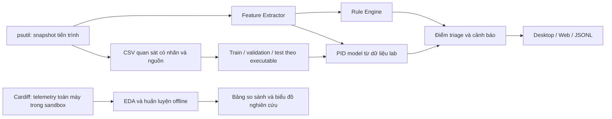

# Kiến trúc và cơ sở lý thuyết ProcessGuard

## Hai luồng dữ liệu

Cardiff và PID có đơn vị quan sát khác nhau. Không chuyển model Cardiff vào bộ chấm PID. Model synthetic chỉ dùng trong chế độ demo. Khi chưa có model PID hợp lệ, live sử dụng rule-based.

## Module và dữ liệu đầu vào

| Module | Vai trò |
|---|---|
| `collector.py` | Snapshot PID/PPID, executable, command line, CPU, RAM, threads, handles, kết nối, I/O delta. Duy trì cửa sổ 5 snapshot và nhận diện bằng PID + create time. |
| `features.py` | Chuyển snapshot thành vector số với thứ tự `FEATURE_COLUMNS` dùng chung cho train và live. Các cờ checked phân biệt trường chưa kiểm tra với kết quả kiểm tra âm tính. |
| `rules.py` | Kết hợp tín hiệu đường dẫn, tên giả mạo, quan hệ cha-con, tài nguyên và enrichment. |
| `signature.py`, `sysmon.py`, `scheduled_tasks.py` | Truy vấn bổ sung theo thao tác người dùng trong desktop; không mặc định có trong mọi snapshot. |
| `pid_ml.py`, `ml.py` | Train PID, chấm điểm dùng chung cho offline/live và nạp model theo nguồn được phép. |
| `apps/desktop/app.py` | Hiển thị cây PID, điều tra bổ sung, ghi mẫu và hành động có xác nhận. |
| `apps/web/server.py` | Dashboard local chỉ đọc, API tiến trình/research/events/performance; cập nhật khoảng 3 giây. |
| `scripts/collect_pid_samples.py` | Thu thập theo phiên cho danh sách PID người vận hành chỉ định, cùng một nhãn và căn cứ; lưu CSV/JSON riêng, không ghi đè. |

## Cơ sở phát hiện

Chữ ký tĩnh như hash nhận diện file đã biết; thay đổi nội dung làm thay đổi hash. Authenticode cung cấp thông tin chữ ký, nhưng chữ ký hợp lệ không đủ để kết luận file lành tính. Phân tích hành vi dùng tài nguyên, mạng, I/O, quan hệ tiến trình và event để tìm dấu hiệu bất thường; các hoạt động hợp lệ cũng có thể tạo cùng dấu hiệu.

Tên gần giống tiến trình hệ thống và executable trong Temp là tín hiệu điều tra. Office tạo script host hoặc shell cần được xem xét cùng command line và bối cảnh. Run/RunOnce và Scheduled Task liên quan khả năng tự khởi động; task trỏ vào executable không chứng minh task đã tạo PID đang xem. CPU/I/O cao có thể do build, nén dữ liệu hoặc antivirus.

Process Explorer hỗ trợ đối chiếu cây tiến trình và chữ ký; ProcMon hỗ trợ quan sát sự kiện file/Registry; Sysmon cung cấp event tùy cấu hình. Khi đối chiếu MITRE ATT&CK, nhóm cần ghi rõ kỹ thuật mà kịch bản thực sự thực hiện cùng evidence. Safe workload của project chỉ tạo CPU, file tạm và loopback; không thực hiện process injection hoặc persistence.

## Đánh giá PID và cảnh báo

Pipeline yêu cầu cả hai lớp, nguồn nhãn, đường dẫn executable và feature số hữu hạn. Tách train/validation/test theo đường dẫn Windows đã chuẩn hóa; mỗi lớp cần tối thiểu 3 executable path để có thể hiện diện ở ba tập. Một executable có thể có nhiều nhãn theo kịch bản nhưng toàn bộ snapshot của path đó vẫn phải ở cùng một tập. Không nhân bản binary sang đường dẫn khác để giả tạo độc lập; split theo path không bảo vệ khỏi cùng binary ở nhiều path hay tương quan giữa các phiên/VM.

Decision Tree, Random Forest và Extra Trees học từ train. Isolation Forest chỉ học trên benign train. Chọn model supervised có F1 validation cao nhất; test dùng để báo cáo. Không fit lại trên validation sau lựa chọn để giữ đúng model đã đánh giá. Báo cáo có manifest phân tập, SHA-256 file nguồn, audit nguồn nhãn và confusion matrix.

Cả offline PID và live dùng cùng hàm score và ngưỡng **0,65**. Supervised lấy xác suất lớp 1; Isolation Forest chuyển `decision_function` sang điểm sigmoid đơn điệu, không phải xác suất malware được hiệu chuẩn. Báo cáo ML-only không đo trực tiếp cảnh báo kết hợp `max(rule_score, ml_score)`. JSON phiên thu thập có cả số snapshot vượt ngưỡng ML và kết hợp để đối chiếu trong lab; các snapshot liên tiếp tương quan nên không coi là các thử nghiệm độc lập.

## Giới hạn và minh chứng

Trường không đọc được do quyền hệ điều hành có thể về giá trị mặc định; thiếu quyền làm giảm độ tin cậy của telemetry. Rolling window tính theo số snapshot, không cố định số giây. Chữ ký/Sysmon/persistence được tra thủ công có thể khác mức enrichment trong dữ liệu train. Không coi vùng executable riêng tư hay Sysmon 8/10/25 là bằng chứng đã có injection.

Phần nâng cao chưa hoàn thành: API/system call trace, so sánh nội dung memory/module và thử nghiệm malware thực trong sandbox. Project hiện không có dataset PID được nhóm xác minh để công bố metric thực tế. Xem [LAB_WORKFLOW.md](LAB_WORKFLOW.md) để thực hiện và ghi nhận phần thực nghiệm.
